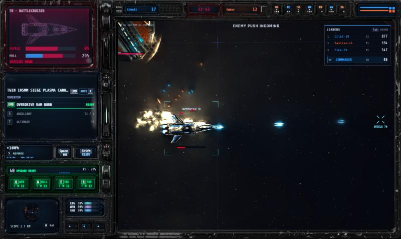
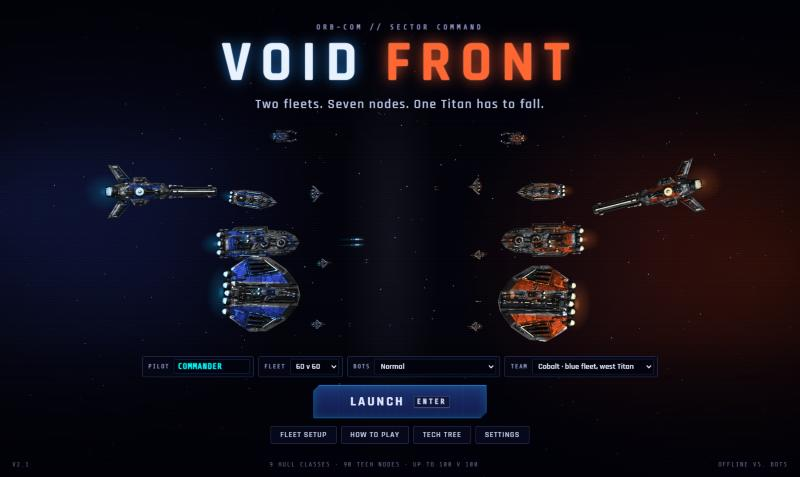
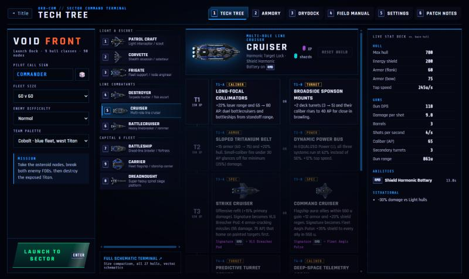
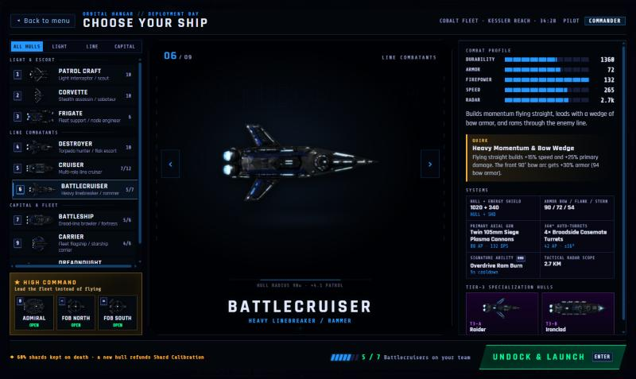
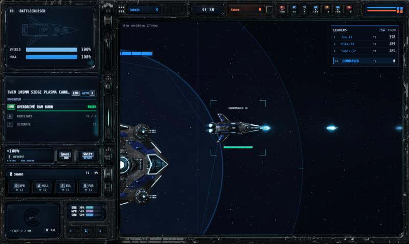
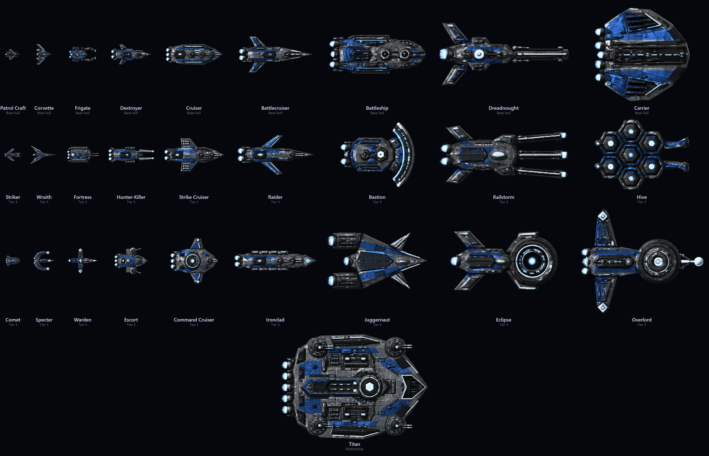

# Void Front

**A browser team space shooter.** Two fleets of up to 100 ships fight across an asteroid field. You fly
one ship, and bots fill every empty slot. Pick a hull from a nimble Patrol Craft up to a Dreadnought or
Carrier, or take a command seat and run the war from the map. Take nodes, earn XP and shards, break the
enemy FOBs, then kill their Titan.



> **Status: offline prototype, v2.1.** Everything below can be played offline against bots:
>
> - 9 hull classes with full five-tier trees (90 upgrade nodes), each with a signature ability and two ultimates
> - Energy shields, plus armor with bow and stern arcs
> - Weapon calibers and overpenetration, Reactor Power shunting, Sub-Light drive and reverse throttle
> - Secondary auto-turrets
> - The shard and XP economy
> - FOBs, the Titan and seven asteroid nodes
> - Command seats (Admiral and FOB Commanders) and High Command base upgrades
> - Per-class tactical AI
> - A lit cockpit HUD over a PixiJS renderer with radiance-cascade lighting
>
> Online multiplayer comes later.

---

## Contents

- [Quick start](#quick-start)
- [Screens](#screens)
- [How a match plays](#how-a-match-plays)
- [Combat](#combat)
- [Movement and the reactor](#movement-and-the-reactor)
- [Progression and economy](#progression-and-economy)
- [The ships](#the-ships)
- [The map](#the-map)
- [Command seats](#command-seats)
- [Bots](#bots)
- [Controls](#controls)
- [The HUD](#the-hud)
- [Visuals and art](#visuals-and-art)
- [For developers](#for-developers)
- [Credits](#credits)

---

## Quick start

You need [Node.js](https://nodejs.org) 20 or newer.

```bash
git clone https://github.com/DARTHLUNCE/void-front.git
cd void-front
npx --yes pnpm@9.15.0 install
npx --yes pnpm@9.15.0 dev
```

Open **http://localhost:5173**. If you have pnpm (`corepack enable` sets it up), plain `pnpm install` and
`pnpm dev` work too. For production builds, hosting, tests, the balance harness and the art tools, see
**[BUILD.md](BUILD.md)**.

The flow is title screen → terminal → hangar → space:

1. Press **Enter** on the title screen to launch with your last setup. Any other option opens the terminal.
2. Set your call sign, fleet size, difficulty and team in the terminal's **Launch Dock**, then press
   **Launch to sector** (or Enter).
3. Pick a hull (keys **1–9**) or a command seat (**0**, **−**, **=**) in the **Orbital Hangar**.
4. Launch with **Enter**, **Space** or a double-click.

---

## Screens

| | |
|---|---|
|  |  |
| **Title screen.** A live bot skirmish plays behind the logo. Enter launches straight into a match, and the other options open the terminal. | **Terminal.** The Launch Dock is on the left. On the right are six numbered tabs: Tech Tree, Armory, Drydock, Field Manual, Settings and Patch Notes. Esc returns to the title. |
|  |  |
| **Orbital Hangar.** A hull picker with live sprite previews, stats, the per-team cap, and the three command seats. | **Pilot cockpit.** A lit, beveled sidebar frame around the battlefield, with every instrument on the left and the score at top right. |

### Launch Dock options

| Option | Choices |
|---|---|
| Pilot call sign | Up to 16 characters (A–Z, 0–9, `-`, `_`). The dice button rolls a random preset. |
| Fleet size | 20 v 20, 40 v 40, 60 v 60, 100 v 100 |
| Enemy difficulty | Easy (slow reactions, loose aim), Normal, Hard (full spec skill) |
| Team palette | Cobalt (blue fleet, west Titan) or Ember (orange fleet, east Titan) |

### Terminal tabs

| Tab | What's in it |
|---|---|
| **Tech Tree** | Plan a build. Covers every class, all five tiers, the Shard Calibration steppers, the Reactor Power toggle and the hull sprites. |
| **Armory** | Guns against armor. An interactive caliber-vs-Armor-Rating simulator. |
| **Drydock** | Cosmetics: hull finish (reference team paint, neutral tactical gray, original vector), engine plume tint and weapon bolt color. |
| **Field Manual** | How to play, in chapters. |
| **Settings** | Steering (mouse or WASD), Pilot HUD layout (cockpit sidebar or bottom bar), lighting, derived normal maps and the performance readout. |
| **Patch Notes** | What's new. |

Every setting saves as soon as you change it.

---

## How a match plays

**Objective: destroy the enemy Titan.** Each side has a Titan (mothership) at its end of the map and
two **FOBs** (forward operating bases) in front of it:

- The Titan is **shielded until both of its FOBs are destroyed**.
- Destroying an enemy FOB leaves a salvage beacon that your team can respawn at.
- Titans and FOBs carry their own heavy twin turrets and heal friendly ships in range.

| Structure | Hull | Turrets | Heal aura |
|---|---|---|---|
| Titan | 60,000 | 4 twin turrets: 1,600 range, 160 AP | 1,050 u |
| FOB | 36,000 | 2 twin turrets: 1,300 range, 130 AP | 800 u |

Structure hull scales up with fleet size: from 40 ships per side up to ×2.5. A 100 v 100 Titan is far
tougher than a 20 v 20 one.

**The asteroid nodes** in the middle pay your commanders every minute and give your whole team a buff.
To take one:

1. Fly into its 450 u ring. Up to 4 ships capture faster, and cloaked ships capture at half rate.
2. If the enemy holds it, shoot it down first.
3. A destroyed node is locked for 20 s before anyone can capture it again.

At **8, 16 and 24 minutes** a node becomes a **hot zone** and pays double for 3 minutes.

**Time limit: 35 minutes.** If neither Titan falls by then, victory points decide the winner:

- 1 VP for every 1% of the enemy Titan's hull you have removed
- 15 VP per enemy FOB destroyed
- 3 VP per node held

A tie goes to the side with more kills. Bot matches usually run 20–30 minutes.

**Scoreboard.** Tab opens the full board, and the top-right panel shows the leaders and your own rank.
Score is bragging rights and doesn't buy anything.

| Action | Score |
|---|---|
| Kill | 100 + 10 per rank of the victim |
| Assist (at least 10% of the damage) | half a kill |
| Damage to ships / healing | 0.1 per point |
| Damage to structures | 0.02 per point |
| Node capture | 150 (+2 per second capturing) |
| Node destroyed / FOB or Titan destroyed | 75 / 300 |
| Commanders: orders and upgrades bought | 1 per resource spent |

---

## Combat

### Shields

Every hull has an energy shield that takes hits before the hull does:

- **Any shield left soaks the whole hit.** A shield on its last 20 points still stops a 40-damage shell
  completely. It is the bubble that breaks, not the hull behind it.
- Shields regenerate 8% per second after 3.5 s without damage. With Reactor Power on SHIELDS they keep
  a 2% trickle going even under fire.
- Some weapons skip the shield. The Corvette's nullifiers and certain EMPs send part of their damage
  straight to the hull.

### Hull and repair

**There is no natural hull regeneration.** The shield is the only thing that recharges on its own. Hull
comes back only from:

- A **Frigate**: its nanite lance, Repair Pulse, Warden Tether or Aegis Sanctuary.
- **Upgrades** that grant hull regen or repair, such as the Carrier's Escort Shield Harmonic and the
  Destroyer's Reinforced Bow Bulkheads.
- The **heal aura** around your own Titan and FOBs.

### Armor and caliber

Every hull has an **Armor Rating**, and every gun a **caliber** in AP (armor penetration):

| Rule | Effect |
|---|---|
| Bow arc (front 90°) | +25% armor. Point your nose at the enemy. |
| Stern arc (rear 90°) | Armor ×0.75. Flankers hunt sterns. |
| AP well below armor | Damage scales as (AP ÷ armor)^0.75, never below 25%. Glancing hits throw sparks. |
| AP ≥ 3.5× armor | **Overpenetration**: the slug punches straight through for 65% damage. A heavy gun wastes shots on thin scouts. |

Light guns shred light ships but bounce off battleships. Capital guns crack battleships but overpenetrate
Patrol Craft. Asteroid nodes are solid rock that blocks every shot, so use them for cover.

### Secondary turrets

Frigates and every bigger hull mount loose, auto-aiming **secondary turrets** that fire on their own:
flak, deck batteries, casemates, point-defense blisters and CIWS. Each has its own caliber and aim jitter,
and tier upgrades tighten their aim or add more mounts.

### Kills and assists

The kill goes to whoever dealt the most damage in the last 10 s. Anyone else who did at least 10% of the
damage gets an assist.

---

## Movement and the reactor

### Steering

Ships turn toward the aim point and carry real inertia: they drift, bank, and decelerate when you brake.
Bigger hulls turn and accelerate slowly. Firing your main gun bleeds off some speed.

### Throttle

The mouse wheel sets throttle from −40% to +100% in 10% steps:

- Below zero you back up with your nose still on the aim, so you can kite with your bow armor forward.
- **S** (mouse scheme) toggles reverse.
- Some upgrades raise the reverse ceiling to −45%, −50% or −55%.

### Sub-Light drive

Hold **Shift**. The drive spools for 0.7 s, then gives ×2.5 speed. Any hit drops you out, and it doesn't
work in reverse.

### Reactor Power

Shift reactor output between three subsystems with the arrow keys:

| Key | Setting | Speed | Weapons | Shields |
|---|---|---|---|---|
| ↓ | Equalized | 50% | 50% | 50% |
| ← | **SPEED** | 100%: ×1.25 speed, faster acceleration and Sub-Light spool | 33% | 33% |
| ↑ | **WEAPONS** | 33% | 100%: ×1.25 damage, +15% AP, faster secondaries, less heat | 33% |
| → | **SHIELDS** | 33% | 33% | 100%: ×1.4 shield, double regen, 15% damage reduction |

Many upgrades key off your power setting. For example, the Carrier's escorts inherit it, the Patrol's
Slipstream builds twice as fast on SPEED, and the Frigate heals harder on SHIELDS.

---

## Progression and economy

Two currencies drop during a match, and both reset when it ends.

### XP buys tiers

| Tier | 1 | 2 | 3 | 4 | 5 |
|---|---|---|---|---|---|
| XP cost | 150 | 350 | 650 | 1,050 | 1,600 |

Each tier offers two options; press **1** or **2** when the pop-up shows.

- **Tier 3 swaps your hull** for one of two variants with new art and a new signature ability.
- **Tier 5 unlocks your ultimate** on **T**.

XP comes from:

- Kills: 40 + 15 per rank of the victim, with a ×1.6 bounty on ships two or more ranks above you.
- Damage, healing, capturing and defending nodes.
- Destroying nodes.

A team that trails earns up to +60% XP to help it come back.

### Shards buy Shard Calibration

Shards come from crystals and wreck loot. Each track has 7 levels.

| Track | Per level |
|---|---|
| Weapons | +8% damage, +2 AP |
| Hull & Plating | +15% hull & shield, +3 armor |
| Engines | +7% speed and reverse |
| Reactor | +6% fire rate & shield regen, −5% cooldowns |

| Level | 1 | 2 | 3 | 4 | 5 | 6 | 7 |
|---|---|---|---|---|---|---|---|
| Shard cost | 12 | 18 | 26 | 36 | 50 | 68 | 90 |

**Calibration respecs whenever your hull changes:** a Tier-3 hull swap, a class change or a redeploy.
Every shard you spent comes back so you can rebuild for the new frame.

### Dying

- You keep 60% of your unspent shards. The other 40% drops as loot for whoever is nearby.
- XP and tiers are kept.
- Respawning takes 5 s + 1.2 s per rank (capped at 11 s), scaled by hull size: Patrol ×0.55 up to
  Dreadnought ×1.6.

---

## The ships



There are nine classes. Bigger hulls hit harder and carry more armor and turrets, but turn slowly,
respawn slowly, and are capped per team. The caps below are for a 60-ship fleet.

| Class | Role | Hull + Shield | Armor | Speed | Main gun (AP · DPS) | Turrets | Cap |
|---|---|---|---|---|---|---|---|
| **Patrol Craft** | Light interceptor / scout | 320 + 120 | 15 | 360 | Twin 20mm Pulse Lasers (22 · 88) | — | — |
| **Corvette** | Stealth assassin | 360 + 140 | 20 | 335 | Twin 30mm Phase Repeaters (34 · 127) | — | — |
| **Frigate** | Fleet support / node engineer | 470 + 200 | 32 | 270 | Axial Nanite Lance (32 · 110) | 1 PD | — |
| **Destroyer** | Torpedo hunter / flak escort | 540 + 180 | 45 | 280 | Dual 50mm Autocannons (52 · 102) | 2 flak | — |
| **Cruiser** | Multi-role line cruiser | 780 + 280 | 60 | 245 | Triple 75mm Lasers (65 · 118) | 3 deck | 12 |
| **Battlecruiser** | Heavy linebreaker / rammer | 1,020 + 340 | 72 | 265 | Twin 105mm Siege Plasma (88 · 132) | 4 casemate | 7 |
| **Battleship** | Dread-line fortress | 1,500 + 500 | 92 | 195 | Twin 150mm Gauss (105 · 70) | 6 deck | 6 |
| **Dreadnought** | Spinal siege platform | 1,600 + 620 | 110 | 165 | 240mm Spinal Rail (135 · 75, 1,450 range) | 8 PD | 3 |
| **Carrier** | Fleet flagship | 1,350 + 560 | 82 | 185 | Command Designator Beam (48 · 68) | 6 CIWS | 6 |

Every class has a passive **quirk**, a **signature ability** on right-click and a five-tier tree. Expand a
class for its full kit.

<details>
<summary><b>Patrol Craft</b>: Slipstream Momentum · Phase Dash · Striker / Comet</summary>

The smallest, most agile frame. Thin 15 armor lets heavy shells overpenetrate it, and its pulse lasers
shred light craft and exposed sterns.

- **Quirk: Slipstream Momentum.** Flying within 30° of straight for 1.8 s builds +15% speed and +25% fire
  rate. SPEED power doubles the buildup. A sharp turn or a hit resets it.
- **Signature: Phase Dash** (5 s). A 3.2× speed burst for 0.3 s, invulnerable to projectiles.

| Tier | Option A | Option B |
|---|---|---|
| 1 | **Focused X-Ray Lenses**: 22 → 38 AP, +12% range | **Rotary Scatter Array**: +1 barrel, +20% fire rate, −12% per shot |
| 2 | **Shunt Afterburners**: Phase Dash holds 2 charges; softer SPEED drain | **Electronic Chaff Hull**: doubles enemy turret jitter vs you, +35% shield |
| 3 | **Striker** hull: Blink Strike, a 420 u micro-warp and 65-damage EMP arc that drains 50% of enemy shields | **Comet** hull: +15 armor; Kinetic Ram for 110 high-AP damage and knockback, reset on kill |
| 4 | **Stern Exhaust Seeker**: stern hits ignore 50% armor and slow turning | **Tri-Flux Power Coupler**: switching power gives a 2.5 s surge to all systems and 30 shield |
| 5 | **Vector Storm**: 6 s of cooldown-free dashes with all power at 100% | **Armor-Stripper Micro-Pods**: 8 micro-missiles that strip −30 armor |
</details>

<details>
<summary><b>Corvette</b>: Ghost Drive · Ambush Cloak · Wraith / Specter</summary>

A cloaked striker. It opens from stealth with a heavy armor-piercing volley, and enemy secondary turrets
ignore it while it is cloaked.

- **Quirk: Ghost Drive.** Cloaks automatically after 3 s without firing or taking damage. Firing breaks it.
- **Signature: Ambush Cloak** (11 s). Cloak for 4.5 s; the opening volley deals ×2 with bonus penetration.

| Tier | Option A | Option B |
|---|---|---|
| 1 | **Shield-Piercing Nullifiers**: +18 AP; 40% of damage bypasses shields | **Suppressed Phase Emitters**: first 2 volleys keep the cloak; reverse to −55% |
| 2 | **Phase Slip Thrusters**: Ghost Step (G), a 280 u blink while cloaked | **Radar-Absorptive Carapace**: invisible to scans and the minimap, +40% shield |
| 3 | **Wraith** hull: 5.5 s ambush with a ×2.6 opening at 110 AP | **Specter** hull: ambush spawns 3 holographic decoys |
| 4 | **Demolition Saboteur**: ×2.2 vs nodes and structures after decloaking | **Reactor Executioner**: +35% vs targets under 40% hull; stern hits lock their power |
| 5 | **Shadow Guillotine**: blink behind a target for a ×2.8 stern volley | **Sensor Blackout Shroud**: a 750 u field that kills enemy HUDs and turrets for 7 s |
</details>

<details>
<summary><b>Frigate</b>: Field Engineer · Repair & Shield Pulse · Fortress / Warden</summary>

The fleet's healer. It repairs ships and friendly nodes with its nanite lance, captures twice as fast, and
fortifies nodes into strongpoints.

- **Quirk: Field Engineer.** Captures nodes at 2× rate. The lance repairs friendly ships and nodes (never
  FOBs or Titans) for 55% of shot value.
- **Signature: Repair & Shield Pulse** (10 s). A 350 u burst: +30% hull and +40% shield to you and nearby
  allies, and 8% repair to a friendly node.

| Tier | Option A | Option B |
|---|---|---|
| 1 | **High-Density Nanite Matrix**: healing 55% → 85% of damage | **Deconstructor Beam**: 32 → 58 AP, +35% vs structures |
| 2 | **Orbital Sentry Kit**: deploy a 450-hull turret (G), +1 dorsal turret | **Magnetic Anchor Mines**: 5 mines (G) that drain the victim's reactor |
| 3 | **Fortress** hull: +18 armor; the pulse drops a shield dome and arms nearby nodes | **Warden** hull: Warden Tether, 14%/s hull and shield to one ally plus +25 armor |
| 4 | **Node Bastion Protocol**: the pulse heals nodes +15% and gives them +40 armor | **Fleet Power Conduit**: healed allies get a +15% power surge |
| 5 | **Node Citadel**: a node goes to 12,000 hull with 2 turrets and becomes a spawn for 60 s | **Aegis Sanctuary**: a 550 u field healing 10%/s with +35 armor for 8 s |
</details>

<details>
<summary><b>Destroyer</b>: Point-Defense Screen · Heavy Torpedo · Hunter-Killer / Escort Leader</summary>

Armor-piercing torpedoes for capital ships, and twin flak turrets that swat starships and missiles.

- **Quirk: Point-Defense Screen.** Flak shoots down 1 missile or torpedo within 360 u every 0.6 s and
  deals ×2 damage to starships.
- **Signature: Heavy Torpedo** (8.5 s). A homing torpedo: 115 damage at 105 AP, ×1.5 vs structures.

| Tier | Option A | Option B |
|---|---|---|
| 1 | **Proximity Frag Shells**: splash, no overpen, +25% vs Patrol and Corvette | **Capped AP-Sabot**: 52 → 70 AP, −20% torpedo cooldown |
| 2 | **Auxiliary Fire-Control**: −45% flak jitter, +1 flak turret | **Vectored Retro-Burners**: Evasive Burn (G), reverse to −50% |
| 3 | **Hunter-Killer** hull: a 3-torpedo fan that sunders armor −20 | **Escort Leader** hull: +15 armor, +2 flak; Flak Curtain |
| 4 | **Laser Target Painter**: painted targets draw +35% turret and torpedo accuracy | **Reinforced Bow Bulkheads**: +45% bow armor; SHIELDS restores 15% hull |
| 5 | **Sequential Tube Salvo**: 5 heavy torpedoes in 1.2 s | **Magnetic EMP Warhead**: strips all shields, silences abilities, drains the reactor |
</details>

<details>
<summary><b>Cruiser</b>: Harmonic Target Lock · Shield Harmonic Battery · Strike / Command Cruiser</summary>

Triple lasers that lock on harder the longer they fire, three deck turrets, and a shield battery that
soaks a focused volley.

- **Quirk: Harmonic Target Lock.** Sustained fire ramps the lasers over 3 s, up to +20% damage and
  +20 AP (65 → 85).
- **Signature: Shield Harmonic Battery** (13 s). Restores 45% shield and blocks 55% of all damage for 4 s.

| Tier | Option A | Option B |
|---|---|---|
| 1 | **Long-Focal Collimators**: +22% range, 65 → 80 AP | **Broadside Sponsons**: +2 deck turrets at 40 AP |
| 2 | **Sloped Tritanium Belt**: +15 armor, +20% hull; small calibers glance | **Dynamic Power Bus**: equalized power runs at 62%; +12% speed |
| 3 | **Strike Cruiser** hull: +15% damage; VLS Breacher Pod missiles | **Command Cruiser** hull: an aura of +12 armor and +20% shield regen; Fleet Aegis Pulse |
| 4 | **Predictive Turret Servos**: −50% jitter, faster on WEAPONS | **Deep-Space Telemetry**: +35% vision; hits reveal cloaks and strip −15 armor |
| 5 | **Battery Overclock**: ×1.8 fire rate with zero-jitter turrets for 6.5 s | **Coherent Ion Lance**: a 1,450 u beam, 240 damage to everything in line |
</details>

<details>
<summary><b>Battlecruiser</b>: Heavy Momentum & Bow Wedge · Overdrive Ram Burn · Raider / Ironclad</summary>

Builds momentum flying straight, leads with a wedge of bow armor, and rams through the enemy line.

- **Quirk: Heavy Momentum & Bow Wedge.** Flying straight builds +15% speed and +25% damage. The bow arc
  gets +30% armor (94).
- **Signature: Overdrive Ram Burn** (9 s). Surges forward at 2.5× speed for 0.55 s. Ships you hit take
  95 damage and are knocked aside, and your armor doubles while it lasts.

| Tier | Option A | Option B |
|---|---|---|
| 1 | **Depleted-Core 120mm**: 88 → 112 AP, +18% damage | **Anti-Screen Plasma Canisters**: splash, no overpen, +15% fire rate |
| 2 | **Broadside Casemate Crew**: +2 casemates, −35% jitter | **Twin Afterburner Injectors**: 2 ram charges, reverse to −50% |
| 3 | **Raider** hull: +15% speed; Micro-Jump Strike | **Ironclad** hull: +22 armor, +25% hull, knockback immune; a stunning ram |
| 4 | **Breacher Momentum**: at full momentum, ignore 25% of shields; +30% vs damaged targets | **Kinetic Shield Dynamo**: glancing hits restore shield; kills halve the cooldown |
| 5 | **Devastator Prow Salvo**: 8 piercing 120mm shells | **Tri-Core Reactor Overload**: all power at 100%, +35% speed and fire rate for 7 s |
</details>

<details>
<summary><b>Battleship</b>: Thermal Reactor Ride · Bulwark Plating Matrix · Bastion / Juggernaut</summary>

Twin gauss batteries that hit harder running hot, six secondary batteries, and plating that shrugs off
small calibers.

- **Quirk: Thermal Reactor Ride.** Firing builds heat. Above 50% heat, guns deal +25% damage with +15 AP.
  At 100% the main guns vent for 1.8 s.
- **Signature: Bulwark Plating Matrix** (12 s). +60 armor and absorbs 75% of damage for 4.5 s.

| Tier | Option A | Option B |
|---|---|---|
| 1 | **180mm Super-Heavy Shells**: 105 → 130 AP, +28% per shot | **HE Canister Shot**: a 3-shell spread with splash |
| 2 | **Layered Citadel Belt**: +18 armor, +20% hull, reverse to −45% | **Secondary Battery Director**: +2 batteries, −35% jitter, 30% slower heat |
| 3 | **Bastion** hull: +25% shield; Aegis Mirror reflects projectiles | **Juggernaut** hull: Thermal Overdrive, no heat and +75% fire rate |
| 4 | **Bow-Tank Stabilizers**: knockback immune; braced on SHIELDS takes −30% damage | **Thermal Turret Coupling**: hot batteries fire incendiary plasma |
| 5 | **Siege Bastion Mode**: +50 armor, ×1.8 range with splash for 8 s | **Citadel Aegis Dome**: a 650 u dome that stops every enemy projectile |
</details>

<details>
<summary><b>Dreadnought</b>: Spinal Capacitor · Hyper-Velocity Rail Beam · Railstorm / Eclipse</summary>

The biggest gun in the fleet: a charged 240mm spinal rail that slips through scouts and guts capital
ships. It is slow to turn and slow to die.

- **Quirk: Spinal Capacitor.** Hold fire for 1.4 s for a ×3 full-charge slug that pierces 2 more ships.
- **Signature: Hyper-Velocity Rail Beam** (7 s). An instant 1,250 u beam: 135 damage at 125 AP to every
  enemy in line.

| Tier | Option A | Option B |
|---|---|---|
| 1 | **Fragmenting Sabot**: no overpen penalty, plasma wake | **Cryo-Cooled Rail Coils**: −30% charge time, +20% range |
| 2 | **Recoil-Assisted Retro Thrusters**: full charges in reverse push you back | **Flak Blister Network**: +2 blisters that shoot down torpedoes |
| 3 | **Railstorm** hull: 3 rail beams in a spread | **Eclipse** hull: +20 armor; Event Horizon singularity |
| 4 | **Citadel Cavitator**: +40% vs armored ships, ruptures armor −25 | **Monolithic Bow Armor**: 130 armor; calibers under 65 AP glance |
| 5 | **Orbital Siege Lance**: 450 to ships, 900 to structures | **Graviton Singularity Wave**: yanks flankers in front of your bow and stuns them |
</details>

<details>
<summary><b>Carrier</b>: Armored Flight Deck · Scramble Strike Wing · Hive / Overlord</summary>

A fleet flagship with two permanent escort starships, strike wings on demand, and six CIWS mounts
guarding the flight deck. The escorts launch off the bow like a runway and orbit wide and evenly spaced,
so you can always count them.

- **Quirk: Armored Flight Deck.** 2 permanent escorts (relaunch 7 s) inherit your Reactor Power:
  SPEED +30% speed, WEAPONS +25% damage and AP, SHIELDS +40% hull.
- **Signature: Scramble Strike Wing** (12 s). Launches 4 strike starships for 14 s.

| Tier | Option A | Option B |
|---|---|---|
| 1 | **High-Velocity Interceptor Wing**: +35% starship speed, 45 AP cannons | **Armor-Piercing Bomber Wing**: 95 AP micro-torpedoes, ×2 vs structures |
| 2 | **Double-Deck Hangar Bays**: 4 permanent escorts | **Phalanx CIWS & Armored Deck**: +2 CIWS, +15 armor; escorts shoot missiles |
| 3 | **Hive** hull: a 7-starship swarm; hits siphon shield | **Overlord** hull: +20 armor; Fleet EMP Pulse |
| 4 | **Integrated Fire-Control Uplink**: the designator paints targets for the wing | **Escort Shield Harmonic**: hull regen per starship; ally damage reduction |
| 5 | **Bastion Flight Deck**: anchor, 10 heavy starships, 4 turrets | **Valkyrie Torpedo Run**: every starship fires a homing torpedo |
</details>

The full interactive tree, with every sprite and number, is in the terminal's **Tech Tree** tab
(`packages/client/public/tech-tree-v2.html`). A standalone build planner is in
[docs/tech-tree.html](docs/tech-tree.html).

---

## The map

**Kessler Reach** is 22,000 × 11,000 u:

- Cobalt's Titan sits on the west edge and Ember's on the east.
- Each Titan has a north and a south FOB in front of it.
- An asteroid field with seven nodes lies between them.

Bases and nodes drift slowly in place so the field never looks frozen.

| Node | Resource | Team buff |
|---|---|---|
| **Research Lab** (center) | none | +25% XP |
| North Camp / South Camp | Manpower | +10% vision |
| West Refinery / East Refinery | Fuel | +10% shield regen |
| West Arsenal / East Arsenal | Munitions | −5% ability cooldowns |

Nodes have 6,000 hull, 65 armor and their own turret (70 AP, 700 range). After 8 s without damage they
slowly repair themselves. Each held node pays 10 of its resource every minute, and each living FOB pays 20.
A team starts with 40 in the bank, and the bank caps at 500.

---

## Command seats

Up to three humans per team can command instead of flying.

**Using the war map:**

- Pan with WASD, the arrows or the screen edge, and zoom with the wheel.
- Right-click to ping a target for free. Bots answer pings.
- Spend what your nodes and FOBs pay on orders with hotkeys **1–9, 0, −, =**, then **Z X C V B N**, in
  panel order.
- Orders cost 30% less while your team holds 2 nodes or fewer.

### Admiral (on the Titan, hangar key 0)

| Order | Resource | Cost | Effect |
|---|---|---|---|
| Orbital Strike | Munitions | 90 | A 600 u circle: 3 s warning, then 400 to ships and 2,000 to structures |
| Black Hole Bomb | Munitions | 80 | A 500 u singularity for 6 s that drags ships and starships inward |
| A-Bomb | Munitions | 200 | A 1,000 u blast: 650 to ships, 5,000 to structures |
| EMP Bomb | Munitions | 70 | 700 u: stun 1.5 s, silence 5 s, starships fried, turrets dark 10 s |
| Radar Jammer | Munitions | 45 | The enemy map goes dark to your ships for 30 s |
| Recon Scan | Munitions | 25 | Reveal 1,500 u for 15 s, cloaks included |
| Defense Platform | Munitions | 60 | A 2,500-hull turret platform for 3 min |
| Fleet Overcharge | Munitions | 70 | −20% ability cooldowns for the whole team, 30 s |
| Forward Beacon | Manpower | 60 | A 90 s spawn point anywhere you can see |
| Rapid Deployment | Manpower | 50 | Team respawns 50% faster for 60 s |
| Rally Order | Manpower | 15 | Half your bots fly to the waypoint for 60 s |
| Hull Reinforcement | Manpower | 80 | Restores 5% of your Titan's hull |
| Breakthrough | Manpower | 120 | Every node you hold pays double for 5 min |

### FOB Commander (North on −, South on =)

FOB Commanders spend Fuel to launch strike craft from their FOB, or from the Titan once the FOB falls.
The wing flies to the spot you click.

| Wing | Cost | What it does |
|---|---|---|
| Fighter Wing | 40 | 4 fighters dogfight around the target for 60 s |
| Interceptor Wing | 45 | 5 fast interceptors hunt starships and drones first, for 45 s |
| Bomber Wing | 60 | 3 slow bombers torpedo nodes, FOBs and structures for 60 s (95 AP, ×3 vs structures) |
| Recon Wing | 15 | 2 spotters give 1,600 u of vision for 60 s |
| Defender Wing | 35 | 4 heavy defenders guard the marked spot for 90 s |

The Admiral covers any FOB seat nobody has taken.

### High Command

High Command takes **10% of the loot from every kill** as Credits and spends them on base upgrades for
the Titan and each FOB:

| Upgrade | Cost | Effect |
|---|---|---|
| Shipyard (3 levels) | 40 / 70 / 110 | +50% heal-aura strength and +100 u radius per level |
| Armor Plating (3 levels) | 40 / 70 / 110 | +15% max hull per level |
| Rocket turret refit | 80 | Homing rockets: 3× damage, 130 u splash, 2.5× slower |
| Laser turret refit | 80 | Near-instant bolts: 2.5× fire rate at 45% damage |

---

## Bots

Bots fill every empty slot on both teams, on three difficulty levels. Each class has its own
**tactical AI**:

- Patrols and Corvettes flank for sterns.
- Frigates shadow and heal the fleet.
- Destroyers screen with flak and hunt capitals with torpedoes.
- Battleships and Dreadnoughts hold the line bow-first.
- Carriers stand off and work their wings.

On top of that, a fleet **director** routes squads between lanes, commits to missions and follows
through on sieges, and bots choose tier upgrades by context.
See [docs/bot-ai.md](docs/bot-ai.md) for the design and
[docs/bot-ai-validation.md](docs/bot-ai-validation.md) for test results.

> **Known issue:** with the new AI, bot-only matches tend to stall and run to the time limit, and Patrol
> Craft and Corvettes score too few kills. Retuning siege pressure and the light-class AI is next on the
> list.

---

## Controls

| Action | Mouse steering (default) | WASD steering |
|---|---|---|
| Move | Point where you want to go | W A S D |
| Brake / hold still | Hold Space | Hold Space |
| Fire main gun | Hold left click | Hold left click |
| Signature ability | Right click | Right click |
| Ultimate (tier 5) | T | T |
| Extra ability (some tier nodes) | G | G |
| Sub-Light drive | Hold Shift | Hold Shift |
| Throttle (−40% … +100%) | Mouse wheel | Mouse wheel |
| Reverse toggle | S | — (S flies backward) |
| Reactor Power: speed / weapons / shields / equalize | ← / ↑ / → / ↓ | ← / ↑ / → / ↓ |
| Shard Calibration (Weapons, Hull, Engines, Reactor) | Q W E R | Z X C V |
| Pick a tier option | 1 / 2 | 1 / 2 |
| Auto-fire toggle | X | F |
| Scoreboard / war map | Tab / M | Tab / M |
| Camera zoom | Ctrl + wheel, or − / = | Same |
| Lighting on/off | L | L |

**Hangar:** 1–9 picks a hull; 0 / − / = picks Admiral, FOB North or FOB South; Enter or Space launches.<br>
**Terminal:** Enter launches; Esc returns to the title.

---

## The HUD

The pilot HUD is a **cockpit sidebar**: a beveled, lit metal frame whose screens glow onto the bezels.
You can switch to the compact **bottom bar** under Settings → Pilot HUD, or with `?hud=bottom` in the URL.

| Instrument | What it shows |
|---|---|
| Hull plate (top left) | Your hull sprite, tier, shield and hull bars. They flash on hits and show "shields down". |
| Weapons panel | Main gun and caliber, auto-fire, signature, extra ability (G) and ultimate (T), with cooldowns |
| Throttle | Signed throttle, reverse, brake and Sub-Light status |
| Calibration | Shards banked and the four Q W E R tracks |
| Reactor | Live ENG / WPN / SHD bars and the power arrows |
| Scope | Minimap with scope range. M opens the full war map. |
| Top bar | Team kills, match clock, node ownership LEDs |
| Leaders (top right) | The top three pilots and your own rank and score |
| In-world | Target reticle with hit / shield / armor markers, damage readouts, call signs, ability prompts |

---

## Visuals and art

### Ship art

Every hull, all 27 hull variants (9 base hulls plus the 18 Tier-3 refits), the Titan, the FOBs and the
strike craft are **painted reference sprites** with full material maps:

- Albedo
- Normal
- Roughness / metal
- Emissive

They are baked into atlases in `packages/client/public/ship-test/` and tinted per team at runtime. The
Drydock offers three finishes: reference team paint, neutral tactical gray and the original flat vector
hulls.
How the atlases and material maps are built, and the Python tools that rebuild them, is covered in
[docs/reference-sprite-test.md](docs/reference-sprite-test.md).

### Lighting

- **Radiance-cascade 2D global illumination.** Engines, muzzle flashes, explosions, shields and station
  lights all cast colored light onto nearby hulls and shadow each other.
- A temporal accumulation pass keeps the light smooth.
- An emissive bloom pass makes engines and weapons glow.
- Lighting cost is set by `LIGHT_QUALITY` in `packages/client/src/render/lighting.ts`. The defaults
  (quarter-resolution light buffer, single-trace cascades) stay smooth on ordinary GPUs. **L** toggles
  lighting in game.

### Effects

| Effect | Notes |
|---|---|
| **Weapon bolts** | Bolt size and weight scale with caliber, and torpedoes and missiles have their own projectiles. Glancing hits spark, and overpenetrations punch through. |
| **Shields** | A refractive bubble shaped to each hull. It ripples where it is hit, crackles with lightning as it fails, and shatters when it breaks. |
| **Thrusters** | Animated plumes and motion-aware trails that stretch with speed and bend through turns. |
| **Sub-Light** | A screen-space lens streak and camera push while the drive is engaged. |
| **Abilities** | A catalog of 27 signature VFX: dashes, cloaks, tethers, torpedo fans, domes, singularities, beams and more. |
| **Impacts and wrecks** | Spark flocks, debris and burning hull-shaped wrecks. |
| **World** | Starfield backdrop, slowly drifting asteroid nodes and bases, and team-colored capture rings. |

### Dev pages

Each dev page tests one visual system in isolation. Open them while `pnpm dev` runs:

| Page | What it checks |
|---|---|
| `/inspect.html` | Every hull at true scale. `?lineup=1` re-renders the ship lineup from the in-game sprites into `packages/client/.inspect/lineup.png`. |
| `/ship-test.html` | Every sprite with its material maps |
| `/pbr-check.html` | Material lighting response |
| `/lighting-check.html`, `/asset-lighting-check.html`, `/camera-lighting-check.html` | Radiance cascades |
| `/ship-shadow-check.html` | Hull shadowing |
| `/ability-check.html` | Every ability's VFX |
| `/impact-check.html` | Hit, glance and overpenetration effects |
| `/vfx-motion-check.html` | Trails and plumes under motion |
| `/sublight-check.html` | The Sub-Light lens |
| `/zoom-check.html` | Camera zoom framing |
| `/remaining-ships.html`, `/remaining-assets.html` | Art coverage |

---

## For developers

**[BUILD.md](BUILD.md)** is the full build guide. It covers prerequisites, the dev server, production
builds and hosting, tests, the balance harness, the art pipeline and the dev pages.

The repo is a pnpm workspace:

| Package | What's in it |
|---|---|
| `packages/shared` | The simulation, content data and protocol. Pure TypeScript, deterministic, seeded, 30 Hz. All tuning (classes, tiers, orders, economy) is data in `src/content/`. |
| `packages/client` | The PixiJS v8 renderer, HUD, menus and input. The sim runs in a Web Worker and streams Float32Array snapshots. |
| `packages/harness` | Headless bot-only matches and balance reports |
| `packages/server` | A stub for later multiplayer work |

| Command | What it does |
|---|---|
| `pnpm dev` | Run the game locally |
| `pnpm build` | Production build of the client |
| `pnpm test` | Unit tests (Vitest), including a mirrored-map fairness test |
| `pnpm typecheck` | Type-check every package |
| `pnpm harness --matches 20 --fleet 60 --seed 1` | Simulate bot matches and write `reports/latest.md`. Flags: `--no-bench`, `--out`, `--workers`. |
| `pnpm tech-tree` | Rebuild [docs/tech-tree.html](docs/tech-tree.html) |

The harness scores each run against balance targets:

- Side win rate 45–55%
- Median match 20–30 minutes
- Fewer than 15% of matches reaching the time limit
- Every class between 0.6× and 1.8× average kills
- Tier options picked 35–65%
- At least 15 node flips per match

### Docs

- [BUILD.md](BUILD.md): building, testing and hosting the game
- [docs/SPEC.md](docs/SPEC.md): the original full design
- [rework-concept/CLAUDE_REWORK_SPEC.md](rework-concept/CLAUDE_REWORK_SPEC.md): the v2.0 / v2.1 rework spec
- [docs/bot-ai.md](docs/bot-ai.md): the bot tactical AI
- [docs/reference-sprite-test.md](docs/reference-sprite-test.md): the art pipeline
- [docs/CLAUDE.md](docs/CLAUDE.md): project conventions
- The phase notes in [docs/](docs/): what was built when

### Roadmap

- Fix the AI siege stalemate and light-class balance
- Online multiplayer: the server package and a hosted test build
- More maps

---

## Credits

| | |
|---|---|
| **DARTHLUNCE** | Game design, simulation, classes and tiers, economy, command seats, HUD, art integration |
| **Flockhopper-bit** | Pilot controls, per-class tactical AI, ability and combat VFX, shields and trails |
| **Matthew Olson** | Hangar and terminal remaster, ship effects, hull-shaped shields and wrecks |
