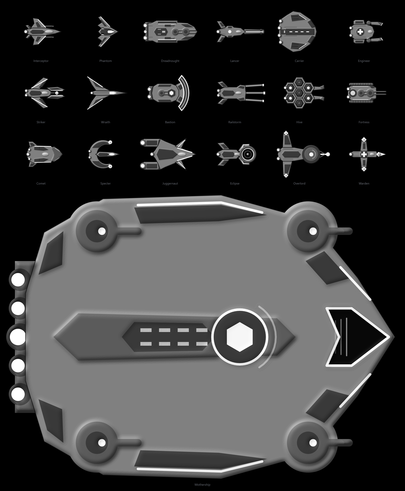

# Void Front

A browser team space shooter. Two fleets of up to 100 ships fight across a large map; you fly one of
them alongside bots that fill every empty slot. Pick a hull class from Patrol Craft up to Dreadnought and
Carrier (or command the fleet from the war map), take nodes, earn XP and shards, and push for the enemy
Titan.



**Status: offline prototype, v2.1.** Nine hull classes with full five-tier trees (90 nodes), energy
shields, Armor Rating with bow and stern arcs, weapon calibers, Reactor Power Shunting, reverse throttle,
secondary auto-turrets, solid asteroid nodes, the shard/XP economy, FOBs, the command seats (Admiral and
FOB Commanders) and High Command base upgrades are playable offline against bots, with detailed sprite
art, distinct strike craft and a cockpit-style HUD. Multiplayer comes later. The v2.0 / v2.1 rework is specified in
[rework-concept/CLAUDE_REWORK_SPEC.md](rework-concept/CLAUDE_REWORK_SPEC.md). See [docs/SPEC.md](docs/SPEC.md) for the full design and the phase
notes in [docs/](docs/) for what's built so far.

## Run it

You need [Node.js](https://nodejs.org) 20 or newer.

```bash
git clone https://github.com/DARTHLUNCE/void-front.git
cd void-front
npx --yes pnpm@9.15.0 install
npx --yes pnpm@9.15.0 dev
```

Open http://localhost:5173. The Launch Dock on the left sets your pilot call sign, fleet size, enemy
difficulty and which team you fly for; the terminal on the right has the Tech Tree & Armory, Cosmetic
Drydock, How to Play, Settings and Patch Notes. Press **Launch to sector**, then pick a hull class
(keys 1–9) or a command seat (Admiral 0, FOB Commander North - or South =) in the Orbital Hangar and
launch with Enter or a double-click. Bigger hulls hit harder, carry more armor and
secondary turrets, but turn and accelerate slowly, respawn slower, and are capped per team.

If you have pnpm installed (`corepack enable` sets it up), plain `pnpm install` and `pnpm dev` work too.

### Home screen

| Where | Options |
|---|---|
| Launch Dock | Pilot call sign, fleet size, enemy difficulty, team palette (fly for Cobalt or Ember) |
| Settings tab | Steering (mouse gimbal or WASD), radiance-cascades lighting (L toggles in game), derived normal maps, performance readout |
| Cosmetic Drydock tab | Hull paint finish (reference team paint, neutral gray, original vector), engine plume tint, weapon bolt color |

**Performance.** Lighting cost is set by `LIGHT_QUALITY` at the top of
`packages/client/src/render/lighting.ts`. The defaults keep the game smooth on ordinary GPUs (quarter
resolution light buffer, single-trace cascades, no hull-on-hull shadows, 6 lights per screen tile). Raise
them on a fast GPU for sharper light and shadows, or turn lighting off with L.

## Controls

| Action | Mouse steering (default) | WASD mode |
|---|---|---|
| Move | Point where you want to go | W A S D |
| Brake / hold still | Hold Space | Hold Space |
| Fire | Hold left click | Hold left click |
| Signature ability | Right click | Right click |
| Ultimate (tier 5) | T | T |
| Extra ability (some tier nodes) | G | G |
| Sub-Light drive (charges 1.5 s, then 2.5× speed; not in reverse) | Hold Shift | Hold Shift |
| Throttle, −40% … +100% in 10% steps (below zero backs up, nose on the aim) | Mouse wheel | Mouse wheel |
| Reactor Power: speed / weapons / shields / equalize | ← / ↑ / → / ↓ | ← / ↑ / → / ↓ |
| Shard Calibration (Weapons, Hull & Plating, Engines, Reactor) | Q W E R | Z X C V |
| Pick a tier (XP) when the pop-up shows | 1 / 2 | 1 / 2 |
| Auto-fire | X | F |
| Scoreboard / map | Tab / M | Tab / M |
| Camera zoom | Ctrl + wheel, or - / = | Same |
| Lighting on/off | L | L |

**Combat (v2).** Every hull has an energy shield that takes hits first and regenerates after 3.5 s
without damage. Overflow strikes the hull through its Armor Rating: the bow arc carries +25% armor, the
stern −25%. Every gun has a caliber (AP): small calibers glance off heavy armor (you'll see sparks), heavy
slugs overpenetrate thin scouts for 65% damage. Frigates and bigger ships carry loose auto-aim secondary
turrets that fire on their own. Asteroid nodes are solid rock that blocks every shot.

You fly for Cobalt (blue) by default, or Ember from the Launch Dock. Win by destroying the enemy Titan
(mothership).
It is shielded until both of Ember's FOBs (the space stations in front of it) are destroyed. Take the
asteroid nodes in the middle for resources (the Research Lab in the center gives +25% XP instead): a
node someone holds has to be shot down, then sits locked for 20 s before it can be captured again.
Destroying an enemy FOB leaves you a salvage beacon to respawn at. FOBs and Titans heal friendly ships
nearby. Only command seats (from the Titan and FOBs) and Carriers launch starships. Bot matches run about 15–25 minutes.

**Economy.** Shards (crystals and wreck loot) buy Shard Calibration levels; each level costs more, and
they are kept all match (v2: no reset when tier 3 swaps your hull). XP from kills, damage, healing and
capturing or defending points buys tiers.
Dying drops 40% of your unspent shards as loot; XP and anything you bought are kept.

**Command seats.** Up to three humans per team can command instead of flying: pan the war map (WASD,
arrows, screen edge, wheel to zoom), right-click to ping targets for free, and spend what your nodes and
FOBs pay each minute on orders (hotkeys 1–9, 0, -, =, then Z X C V B N, in panel order).

- **Admiral** (on the Titan): Munitions (weapons factories) buy Orbital Strike, Black Hole Bomb, A-Bomb,
  EMP Bomb, Radar Jammer, Recon Scan, Defense Platform and Fleet Overcharge; Manpower (training camps)
  buys Forward Beacon, Rapid Deployment, Rally Order, Hull Reinforcement and Breakthrough (nodes pay
  double for 5 min). Buys the Titan's upgrades.
- **FOB Commander** (North or South): Fuel (refineries) launches Fighter, Interceptor, Bomber, Recon and
  Defender wings from their FOB (from the Titan once it falls); they fly out to the spot you click. Buys
  that FOB's upgrades.

The Admiral covers any FOB seat nobody has taken. **High Command** takes 10% of the loot from every kill
as Credits, spent on base upgrades: rocket or laser turrets, Shipyard (stronger, wider heal aura) and
Armor Plating (more hull).

## For developers

The repo is a pnpm workspace:

- `packages/shared`: the simulation, content data and protocol. Pure TypeScript, deterministic and seeded.
- `packages/client`: the PixiJS renderer, HUD and input, with the sim running in a Web Worker.
- `packages/harness`: headless bot-only matches and balance reports.
- `packages/server`: a stub for later multiplayer work.

| Command | What it does |
|---|---|
| `pnpm dev` | Run the game locally |
| `pnpm test` | Unit tests (Vitest) |
| `pnpm typecheck` | Type-check every package |
| `pnpm harness --matches 30 --fleet 60 --seed 1` | Simulate bot matches and write `reports/latest.md` |
| `pnpm tech-tree` | Rebuild `docs/tech-tree.html`, the interactive build planner |

The in-game Tech Tree tab is `packages/client/public/tech-tree-v2.html` (the v2 concept build with every
sprite, Shard Calibration steppers, the Reactor Power toggle and the armor vs. caliber simulator).
Hull art can be reviewed at http://localhost:5173/inspect.html and every sprite at
http://localhost:5173/ship-test.html while `pnpm dev` is running. How the sprite atlases and material
maps are built (and the Python tools that rebuild them) is in
[docs/reference-sprite-test.md](docs/reference-sprite-test.md).
Project conventions are in [docs/CLAUDE.md](docs/CLAUDE.md).
